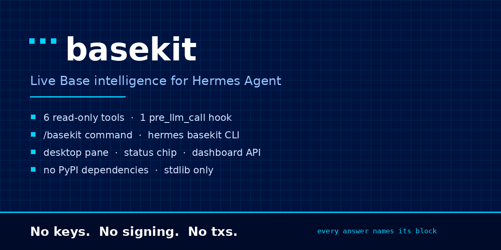
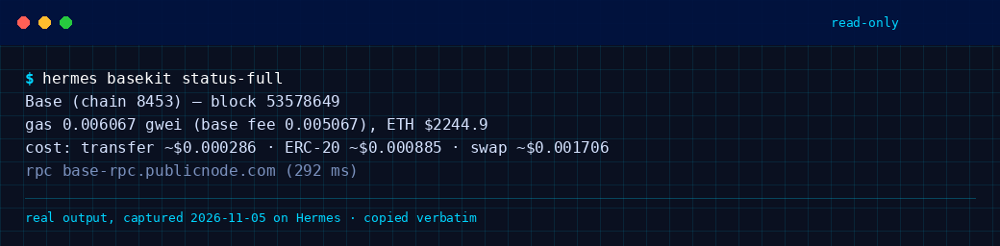
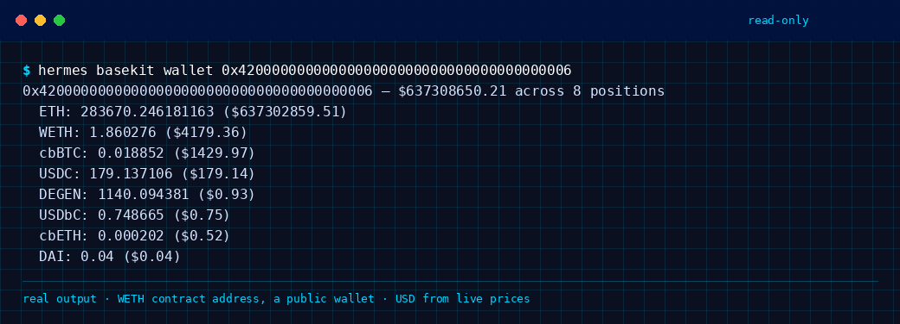
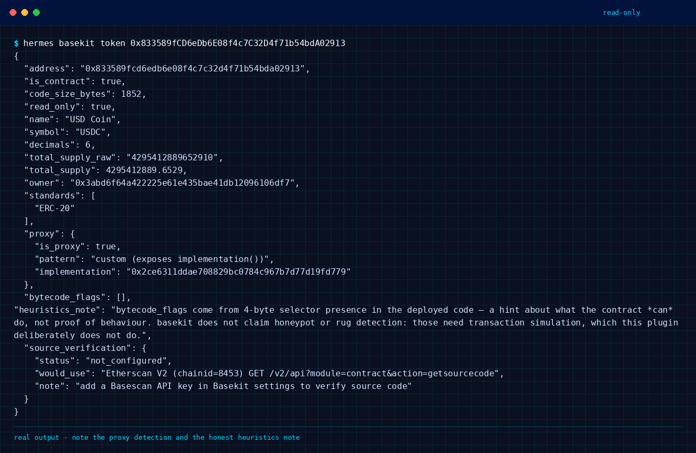
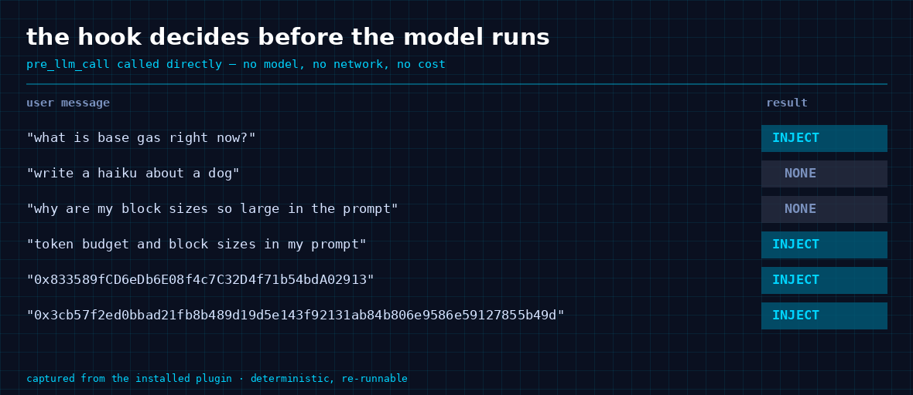

# basekit — live Base intelligence for Hermes Agent

[](https://github.com/D0xedDevi0/hermes-basekit/actions/workflows/ci.yml)

**Hermes Agent Plugin Hackathon entry.** A read-only plugin that gives the agent (and the
desktop UI) real answers about Base — chain 8453 — instead of plausible-sounding ones.

**Demos — every number in both was read from Base mainnet during the recording:**

- [basekit in 84 seconds](https://x.com/D0xedDevi0/status/2118313306314232114) — the plugin working: live chain state, tool calls, real decodes
- [the hook, measured](https://x.com/D0xedDevi0/status/2118380730652721171) — hook on vs off, 82 seconds

Six agent tools, a `pre_llm_call` context injection, a `/basekit` slash command, a
`hermes basekit` CLI command, a bundled skill, a desktop pane, a status-bar chip, a ⌘K
command and a keybind. Built on the standard library alone: **zero PyPI dependencies**.

> **basekit cannot sign, send, or hold anything.** There is no private key, no signer, no
> transaction path — that's a design decision, not a to-do. It reads; you decide.

## See it



**The CLI, reading the live chain** — the RPC endpoint and latency come from the command, so the
numbers say where they came from:



**A portfolio read.** The address is the WETH contract — a public wallet, not anyone's personal one:



**Token facts, with real proxy detection** and the bytecode hints labelled as hints, not verdicts:



**The hook's decision table** — the same function Hermes calls before the model, called directly:



Every image is rendered from captured command output by `scripts/render_screenshots.py`
(commands and dates: [`docs/screenshots/CAPTURE.md`](docs/screenshots/CAPTURE.md)). Same rule as
the [hook measurement](docs/hook-proof.md): no number in a picture that wasn't read off the chain.

## What it does

| Tool | Answers |
| --- | --- |
| `base_network` | Head block, gas/base fee/priority fee in gwei, ETH/USD, and the dollar cost of an ETH transfer, an ERC-20 transfer and a 150k-gas swap. |
| `base_portfolio` | Native ETH + ERC-20 balances with USD values for any address. |
| `base_tx` | Full decode of a tx hash: status, block, UTC time, gas, fee in ETH **and** USD, every ERC-20/ERC-721 transfer, every approval. |
| `base_token` | name/symbol/decimals/supply, `owner()`, real proxy detection (EIP-1967 slot, EIP-1167 clone, `implementation()`), capability hints, optional source verification. |
| `base_activity` | Transfers in/out for one address and one token inside a stated block window. |
| `base_allowances` | Approvals granted on a token, with the **current** allowance re-read on-chain, `unlimited` flags and USD at risk. |

Plus, for Base-related turns only, a cached one-line chain snapshot injected via
`pre_llm_call` (block, gas, ETH price, transfer cost) so the model isn't guessing about
fees.

## Design rules that make it trustworthy

1. **Every answer carries its block.** On-chain state is a moving target; a number
   without a block number is a rumour.
2. **Windowed queries say what they read.** `base_activity` and `base_allowances` report
   `window.from_block` / `to_block` / `blocks` / `narrowed` and tell the model to repeat
   the window: "no transfers in the last 190 blocks" is true; "this wallet never received
   USDC" is not.
3. **No invented numbers.** An unpriced token returns `value_usd: null`. If a value wasn't
   read, the field is absent or null — never a default that looks real.
4. **Heuristics are labelled as heuristics.** `bytecode_flags` are selector-presence hits,
   not behaviour proof. basekit deliberately does **no** honeypot/rug scoring, because a
   verdict it can't back with simulation would be worse than no verdict.
5. **A rejected query is never an empty result.** If `eth_getLogs` is refused, the tool
   raises and explains rather than returning `[]` — because `[]` reads as "nothing
   happened", which would be a false claim about the chain.

## Install

One command, from the Hermes plugin catalog:

```bash
hermes plugins install basekit
```

If the catalog in your build doesn't carry the name yet, install straight from the repo —
identical code, validated by the same gate:

```bash
hermes plugins install D0xedDevi0/hermes-basekit
```

Then make sure it's enabled — **Settings → Plugins**, or:

```bash
hermes plugins enable basekit
```

The desktop half and the Python half each have their own switch, both off by default, which
is standard for unified packages. Nothing is exposed until you turn it on. To use your own
node, set `rpc_url` in the plugin settings.

## Verified against live Base

Not "should work" — measured, on the run that produced this README:

```
block 53,546,070 · gas 0.006 gwei · ETH $2,413.73 · ETH transfer cost $0.000304
rpc base-rpc.publicnode.com · 133 ms
wallet 0x3dbe077e7986… $908,304.27 across 5 positions in 0.33s   (12 tokens scanned)
wallet 0x6131b5fae19e… $877.58 across 11 positions in 0.35s      (same scan)
tx 0x3cb57f2ed0bb… block 53,546,057 · success · 29 logs · fee $0.089520 ·
   7 token transfers + 2 approvals decoded (USDC, METAc, AMZNc)
USDC supply 4,351,207,618 · EIP-1967 proxy detected
```

The offline suite is 106 tests; the live suite is 8 and asserts structure and honesty
rather than prices (a test that pinned a price would be a lie generator), including a
guard that fails if any write/sign method name ever appears in the source. The offline
suites gate every push and PR; the live suite runs on `main` and on demand, informational
because public endpoints rate limit and reorg — the badge at the top of this file is that
workflow, not a decoration.

## The hook, measured — including where the first measurement was wrong

`pre_llm_call` is the part of basekit a prompt or a skill could not replace: Hermes calls it
before the model runs, and it decides on its own whether this turn is about Base at all. Saying
so proves nothing, so it is measured in **[docs/hook-proof.md](docs/hook-proof.md)**:

- the keyword gate, called directly — a Base term fires it, an unrelated turn gets `None`,
  one ambiguous word ("block") is not enough while two ("token" + "block") are, and a bare
  address or tx hash always fires it. Deterministic, no model, no cost to decide;
- the exact string the model receives, captured rather than reconstructed, under 200 tokens,
  cached 60s, failing open;
- an unrelated prompt costing **+6 tokens** against baseline, because the gate returned `None`
  and injected nothing;
- the same question through `hermes -z` with the hook on and off — and here the first version of
  this README claimed **1.33 vs 2.67 model calls**, which turned out to be wrong: the toggle wrote
  to a config file the runtime does not read, so both arms ran with the hook on. Re-measured with
  the plugin's own `load_settings()` asserted before every run and the arms interleaved, the
  difference is **2.40 vs 2.80** model calls on one question and **2.33 vs 2.00** on another —
  pointing in opposite directions, inside noise. **The hook does not reliably remove a tool
  round-trip.** The gate is real; the token saving is not demonstrated;
- what that leaves as a hypothesis rather than a result: across eight valid runs per arm, one
  hook-on run answered in a single call and no hook-off run did. Worth a proper test, not a claim;
- and a postmortem of how the wrong number got published, with the invalid capture kept in
  `docs/evidence/hook-ab.json` rather than deleted.

The raw captures are in [`docs/evidence/`](docs/evidence) with their sha256s, and
`scripts/build_hook_proof.py` regenerates the whole page from them — no number in that
document is hand-typed. The 82-second walkthrough is
[on X](https://x.com/D0xedDevi0/status/2118380730652721171) and in the repo at
[`docs/hook-proof.mp4`](docs/hook-proof.mp4).

```bash
python3 -m unittest discover -s tests -p "test_*.py"   # offline, no network
BASEKIT_LIVE=1 python3 tests/test_live.py              # against real Base
```

## Bugs this suite actually caught

Written honestly, because "it works" claims are cheap and these are the reason to trust
the ones above:

- **Nested-lock deadlock.** `batch()` held the cache lock and then called a cache writer
  that took the same lock. The first smoke run hung and timed out with no output.
- **Multicall3 was encoded wrong twice.** The tuple stride was `3 + payload words`
  instead of `4 + payload words`, and decoded element offsets were measured from the
  wrong base. Both are now pinned by byte-exact vectors and cross-checked against
  `cast calldata` when Foundry is present.
- **A malformed `eth_getLogs` topic array.** `address_word()` returns a bare 64-hex word
  while `TOPIC_TRANSFER` carries `0x`, so the topic array mixed both forms — accepted by
  lenient endpoints, rejected by strict ones. Normalised in one place, with a test that
  asserts the exact wire shape.
- **An empty portfolio that looked like an empty wallet.** `load_token_set(None)`
  returned `[]`, so any caller that omitted the plugin dir scanned zero tokens and
  reported a funded wallet as holding nothing (`$0.00`). Fixed, with a regression test —
  and the fix is why the live portfolio line above shows 11 positions.
- **A silent false negative in log narrowing.** When the retry budget ran out, the code
  returned `[]` — "no transfers" for a query that had actually been *rejected*. Now it
  raises.
- **A stale `translateNow` reference in the desktop half**, found by executing the plugin
  in Node against a stub SDK — a `ReferenceError` at registration that would have shown
  as "nothing appeared" in the app.

## What it touches (disclosure)

Stated plainly, because a user should know this before installing:

- **Outbound HTTPS only**, to a fixed set of hosts — no other network egress:
  - Base JSON-RPC: `mainnet.base.org`, `base-rpc.publicnode.com`, `base.drpc.org`,
    `base.meowrpc.com` (the client fails over across these and reports which answered).
  - Prices: `coins.llama.fi` (DefiLlama) and `api.coinbase.com` (spot fallback).
  - `api.etherscan.io` **only** if you set the optional Basescan key, and only for
    `base_token`'s source-verification field.
- **Reads chain data only.** No files outside its own directory, no shell commands, no
  background processes, no telemetry, no analytics, no usage reporting.
- **The only thing it writes** is a small JSONL read-ledger (which tool asked the chain
  what, when) under `<HERMES_HOME>/plugin-data/basekit/` — that's what feeds the desktop
  pane's recent-activity list.
- **Credentials:** the optional Basescan key is read through Hermes's own secret scope
  (`agent.secret_scope.get_secret`), never from `.env`, `auth.json`, a keychain or any
  other store. basekit stores no credential of its own.
- **No signing, no transactions, no approvals.** There is no key material anywhere in the
  package, and a test fails the build if a write/sign RPC method name ever appears.

## Public RPC reality (read this before filing a bug)

- `eth_getLogs` on public Base endpoints **requires** an `address` filter and caps result
  counts. A 200-block USDC query gets rejected with *"query exceeds max results 20000"*.
  basekit narrows the window toward the head automatically and reports that it did
  (`window.narrowed: true`) rather than failing or pretending.
- One common public endpoint doesn't implement `eth_getLogs` at all, and others rate
  limit (HTTP 429). The client fails over across endpoints and reports which one answered.
- Point `rpc_url` at your own node for wider windows and no rate limits.

## Architecture

```
basekit_core.py      stdlib-only engine: JSON-RPC + failover, TTL cache, Multicall3
                     codec, ABI helpers, token/tx/portfolio/log/price reads
schemas.py           the six tool schemas (separate so they're reviewable/testable)
tools.py             agent-facing handlers -> JSON strings, plus the read ledger
__init__.py          registration: tools, pre_llm_call, /basekit, CLI, bundled skill
tokens.json          12 tokens, each symbol()/decimals() verified on-chain
desktop/plugin.js    pane, status chip, page, palette command, keybind (plain ESM)
dashboard/           plugin_api.py (FastAPI router, /status /portfolio /token /activity
                     /ledger /settings + an authed /events socket) and manifest.json
skills/basekit/      bundled skill: the honesty rules and workflows for the model
tests/               106 offline tests + 8 live, incl. a Node harness that renders the
                     desktop half rather than trusting it
```

One engine serves the agent tools and the dashboard, so the pane and the model cannot
disagree about a number.

## License

MIT.
